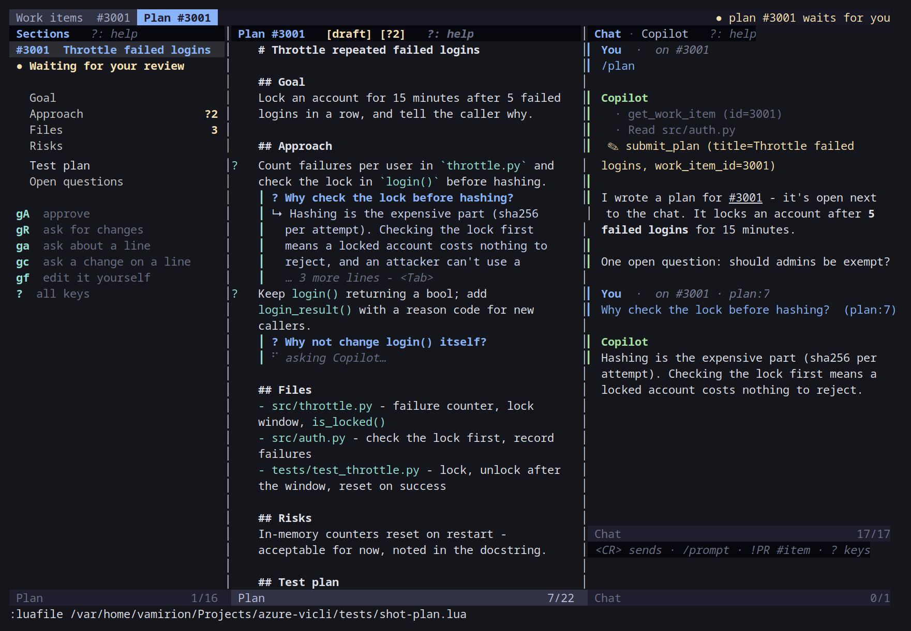
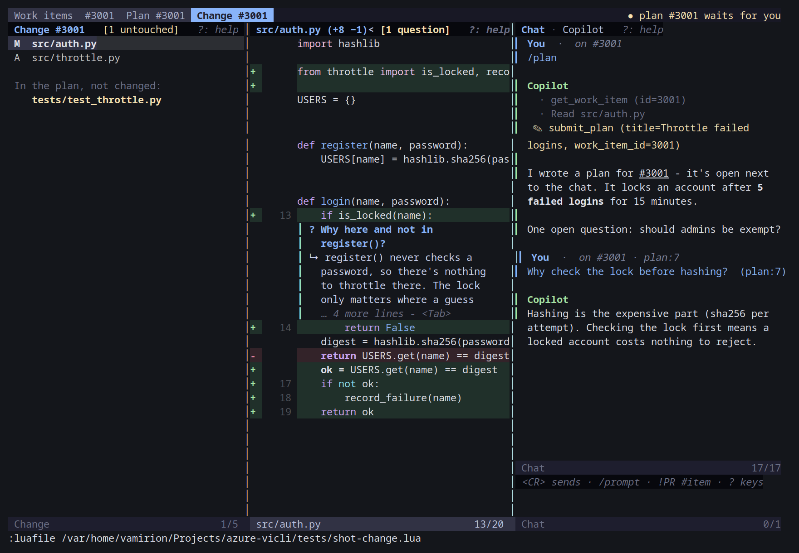

# Chat

_Part of the [azure-vicli](../README.md) docs._

The chat panel puts an AI agent (Claude Code, the GitHub Copilot CLI, or any
command that can use MCP tools) next to whatever you're looking at in
azure-vicli: the PR dashboard, the reviewer, the work items. The agent knows
what's under your cursor and can act on it. You can say things like:

- *"Triage this PR's comments"* (from the reviewer): it reads every thread
  and the diff, tells you what to do about each, and drafts replies.
- *"What do you think about this comment?"* (cursor on a thread): it knows
  which thread, file and line you mean.
- *"Create a branch from develop for this work item"* (on the work items
  screen): it creates the branch on the server, links it to the work item,
  and can check it out locally.
- *"Fix this comment"*: it changes the code in a separate worktree, shows
  you the diff, and commits and pushes it once you allow it, then drafts the
  reply.
- *"Why did the build fail?"*, *"show me where that is"*, *"split this
  story into tasks and move it to next sprint"*, `/standup` ...

azure-vicli ships no agent configuration; you choose the agent and model
(see [Setting it up](#setting-it-up)).

- [Using it](#using-it)
- [Saved prompts, references and selections](#saved-prompts-references-and-selections)
- [Conversations, agents and models](#conversations-agents-and-models)
- [Setting it up](#setting-it-up)
- [Let the agent set itself up](#let-the-agent-set-itself-up)
- [Plans, and asking why](#plans-and-asking-why)
- [What the agent can do](#what-the-agent-can-do)
- [How it works](#how-it-works)

## Using it

`gq` on any azure-vicli screen (or `:AzureCli chat`) takes you to the chat:
it opens the panel, or jumps into it if it's already showing, and puts you
in its input box. `gq` (or `q`) inside the panel hides it, and `<BS>` goes
back to the screen next to it while leaving it open. Once shown, the panel
appears in every azure-vicli tab you visit (dashboard, reviewer, work items)
until you hide it. The conversation is the same in every tab.

| Key (in the panel) | Action |
|---|---|
| `<CR>` (input box, normal mode) / `<C-s>` (while typing) | Send the message |
| `<Up>` / `<Down>` (input box) | Step through the messages you sent |
| `i` / `a` (conversation) | Go to the input box |
| `<CR>` (conversation) | Open the `!PR` or `#work item` under the cursor |
| `<Tab>` (conversation) | Unfold a long answer, or the list of tool calls folded into one line ("· 6 lookups, 2 changes"); again folds it |
| `gw` (conversation) | Ask the agent why it did the step under the cursor (one of its tool calls, `✎ create_branch (...)`) or wrote that line |
| `gr` (conversation) | Draft the answer under the cursor as a reply to the thread its question was about (or a PR comment), queued for `gS` |
| `gp` | Run a saved prompt |
| `gL` | What the agent changed; `u` on a line undoes it |
| `gd` | The agent's code change (a fix or a story), file by file like the reviewer |
| `gh` | Open an earlier conversation |
| `gn` | Start a new conversation (the current one stays in `gh`) |
| `ga` / `gm` | Choose the agent / the model |
| `<C-c>` | Stop the agent |
| `<` / `>` | Make the panel smaller / bigger (kept for the session, in every tab) |
| `<BS>` | Back to the screen next to the panel |
| `q` / `gq` | Hide the panel (`gq` on a screen brings you back to it) |
| `?` | These keys |

Every message is sent together with a description of what you're looking at:
the screen, plus the PR, work item, file, line, code and comment thread under
the cursor in the window you were last in. Your message's heading in the
conversation shows it, e.g. `on PR #101 · auth.py:12 · thread 5000`. Move the
cursor, then ask; "this" always means what's under it now.

While the agent works, its answer appears as it's written (with Claude
Code's `stream-json` output, see below; other agents show their output as it
arrives), along with its tool calls as they happen: azure-vicli's own
(`· get_pr_threads (pr_id=101)`, `✎ draft_reply (...)`) and the agent's
(`· Read src/auth.py`). A spinner turns in the panel's title bar
(`[⠹ working]`) until it's done, and the answer's heading counts the
seconds. With the panel hidden, put it in your statusline:
`require("azure-cli.chat").status()` is `⠹ Copilot 42s` while the agent
works and `""` otherwise (lualine: `{ function() return
require("azure-cli.chat").status() end }`).

**The status strip.** One line says what needs you, from any tab: the
agent working (`⠹ Copilot 42s`), a question waiting for your yes or no
(`⚠ a question waits for you` - a push, a vote), and the plans waiting for
your review (`● plan #3002 waits for you`). The standalone launcher shows
it at the right end of its tab line; in your own Neovim,
`require("azure-cli.chat").strip()` returns it for a statusline (lualine:
`{ function() return require("azure-cli.chat").strip() end }`), or use
azure-vicli's tab line: `vim.o.tabline =
"%!v:lua.require'azure-cli.ui'.tabline()"`.

Once a turn is done, more than three tool calls fold into one line (`· 6
lookups, 2 changes`) - the ones that failed, were declined or were
allowed without asking stay on their own lines - and an answer longer
than 40 lines shows its first 30 and `… N more lines`. `<Tab>` on the
turn unfolds it.

Each turn has a coloured bar down its left side: one colour for you, another
for the agent. The agent's markdown is rendered (headings, **bold**, `code`,
lists, with the markers hidden except on the cursor line). Tool calls are dim
for lookups, warning-coloured for changes (`✎`) and error-coloured when
something failed or you declined it (`✗`). The colours are highlight groups
linked to your colorscheme's, so `:hi` can restyle them: `AzureCliChatYou`,
`AzureCliChatAgent`, `AzureCliChatMeta`, `AzureCliChatToolRead`,
`AzureCliChatToolWrite`, `AzureCliChatToolErr`, `AzureCliChatNote` (keep them
foreground-only, or they paint bands across the panel). The standalone
launcher sets them in its own palette.

## Saved prompts, references and selections

**Saved prompts.** `/triage`, `/review`, `/explain`, `/build`, `/plan` and `/standup`
come built in; type one in the input box (anything after it is added to
the prompt, e.g. `/review focus on error handling`) or pick one with `gp`.
They run against what's on screen like any message. Add your own, replace
or remove the built-in ones with `chat.prompts`:

```lua
prompts = {
  security = "Look for injection, auth and secrets problems in this PR's change.",
  standup = false,   -- remove a built-in one
},
```

**References.** Write `!101` for a pull request and `#3001` for a work item
(type `!` or `#` and a completion menu lists your PRs and work items). The
agent gets a line about each one you name with your message, and writes them
back the same way. In the conversation, `<CR>` on one opens the PR in the
reviewer or the work item in its view.

**Selections.** Select lines (in a diff, the Overview, a work item), then
press `gq`: the panel opens and the next message carries the selected text
and, in a diff, which file lines it covers. The winbar shows
`[selection: N lines]` until it's sent. Without a selection, a message from
a diff carries the change (the run of added/removed lines) around the cursor.

## Conversations, agents and models

The agent stays running for the whole conversation: the first message
starts it, and every later one goes to the same process, which already
knows everything said so far - no new process, no waiting for it to start.

Conversations are saved (under Neovim's data directory, the last 50): the
one in the panel is still there after a restart, `gn` starts a new one, and
`gh` brings back an earlier one.

With several agents configured (`chat.agents`, below), `ga` switches
between them. `gm` picks the model for the current agent. Switching agent
or model, going back to an older conversation with `gh`, or a restart
starts a new process, and your next message replays the conversation to it.

**Proactive.** When the dashboard sees new comments on one of your PRs, a
note appears in the conversation suggesting `/triage` (no agent runs;
`suggest_on_new_comments = false` turns it off). With `daily_summary =
true`, the first time the dashboard loads each day the chat runs `/standup`
in a fresh conversation and tells you when it's ready.

## Setting it up

The panel's placement, and the agent it talks to, go in `setup()` (or the
standalone launcher's `azure-cli.lua`). The agent has to be a CLI that can
stay running across many messages - azure-vicli doesn't start one per
message. Two kinds work:

- **`acp = true`**: a CLI with an [Agent Client
  Protocol](https://agentclientprotocol.com) mode - GitHub Copilot CLI's
  `copilot --acp`.
- **Anything else**: a CLI reading one JSON request per message on stdin and
  streaming JSON events back, without exiting in between - Claude Code's
  `-p --input-format stream-json --output-format stream-json`.

A plain one-shot CLI (`copilot -p "..."`, answering once and exiting)
doesn't work: its first answer arrives, then the chat reports that it
exited.

### GitHub Copilot CLI

```lua
require("azure-cli").setup({
  chat = {
    position = "right",     -- "right" (default), "left", "bottom" or "top"
    size = 0.35,            -- a fraction of the screen, or a number of columns/lines
    input_height = 3,       -- lines in the input box
    agent = {
      label = "Copilot",
      acp = true,
      models = { "claude-sonnet-5", "gpt-5.5" },   -- examples: use the names your `copilot --help` lists
      cmd = { "copilot", "--acp", "--add-dir", "{fix_root}", "--allow-tool", "azure-vicli" },
    },
  },
})
```

azure-vicli (`chat/acp.lua`) does the ACP handshake (`initialize`,
`session/new`) once, then sends one `session/prompt` per message on that
session, with the answer streamed in through `session/update`. The message
goes in `session/prompt` directly, so `stdin` doesn't apply; the model `gm`
picks goes through `session/set_config_option`.

- **azure-vicli's tools.** Copilot's `--acp` (1.0.92) only takes http/sse
  MCP servers - its `initialize` advertises `mcpCapabilities: {http, sse}`,
  and it rejects a stdio one ("Rejecting non-http/sse MCP server
  "azure-vicli" from client"). So for an agent that advertises `http`,
  azure-vicli starts `azure-cli.py --mcp-http` - the same tools as `--mcp`,
  over HTTP on a random 127.0.0.1 port, with the chat's token required on
  every request - once per Neovim, and passes that in `session/new`. An
  agent that doesn't advertise `http` gets the stdio server.
- **Permissions.** A tool call Copilot wants permission for (editing a file,
  running a command) pops up the same yes/no prompt as azure-vicli's own
  tools, with its diff when it has one; "Allow"/"Deny" picks Copilot's
  `allow_once`/`reject_once`. `--allow-tool azure-vicli` saves Copilot
  asking before each of azure-vicli's tools - the ones that change
  something visible still ask you on azure-vicli's side.
- **`--add-dir {fix_root}`** is for "fix this comment" and "implement this
  work item": the agent edits files in a worktree under `{fix_root}`, never
  in your checkout. Leave it out if you don't want the agent changing code.
- **Stopping** a message (`<C-c>`, a timeout) first asks Copilot to stop the
  turn (`session/cancel`), and only stops the process if that doesn't work
  within 5s - so the session normally survives it.

Check `--add-dir` and `--allow-tool` against your `copilot --help`; if
Copilot rejects a flag, the error shows in the chat.

### Claude Code

```lua
agent = {
  label = "Claude",
  models = { "sonnet", "opus", "haiku" },   -- gm picks one; the first is the default
  cmd = { "claude", "-p", "--input-format", "stream-json", "--output-format", "stream-json", "--verbose",
          "--model", "{model}", "--mcp-config", "{mcp_config}", "--add-dir", "{fix_root}",
          "--allowedTools", "mcp__azure-vicli,Read,Grep,Glob,Edit,Write" },
},
```

- Each message goes to its stdin as one line of Claude Code's stream-json
  "user message" (the default `stdin`), and its events stream into the
  panel as they're written.
- `--allowedTools "mcp__azure-vicli"` lets Claude Code use azure-vicli's
  tools without its own prompts (it can't show them in a headless run);
  which changes still ask you is azure-vicli's business, see
  [below](#what-the-agent-can-do).
- `Edit,Write` and `--add-dir {fix_root}` are for the fix and story flows,
  as above.

### Fields

**Several agents.** Instead of `agent`, give `agents = { claude = {...},
copilot = {...} }` and optionally `default_agent = "claude"`; `ga` switches.

| `chat.agent` field | Meaning |
|---|---|
| `cmd` | The command (a list, or a string run through `'shell'` with every value shell-escaped; `acp` needs a list). |
| `acp` | The process speaks the Agent Client Protocol (`copilot --acp`). |
| `stdin` | What each message writes to its stdin, as one line (default: Claude Code's stream-json user message, `{"type":"user","message":{"role":"user","content":[{"type":"text","text":{message_json}}]}}`). Unused with `acp`. |
| `models` / `model` | The models `gm` offers (strings, or `{ label, value }`) and the default. Reaches the agent through `{model}` (`acp`: `session/set_config_option`). |
| `label` | The agent's name in the panel. |
| `strip` | Lua patterns: output lines matching any are dropped (a CLI's own log of its tool calls). Unused with `acp`. |
| `env`, `timeout_seconds` | Extra environment; how long a message may take (default 900) - a timeout stops the process (`acp`: asks the agent to stop the turn first). |

`followup`, `session_pattern` and `persistent` are gone: they were for
starting a process per message and resuming a session each time. A config
that still has them gets an error saying so.

Placeholders: `{message}` (your message, with the view description, the
references and, on the first message, the instructions), `{message_json}`
(the same as a JSON string - quoted and escaped), `{text}` (just what you
typed, prompts expanded), `{view}` (the view description), `{mcp_config}`
(the MCP config file - `acp` passes the server in `session/new` instead),
`{fix_root}` (where fix and story worktrees live), `{model}`.

The process is stopped (and the next message starts a new one, with the
conversation replayed) on `ga`, `gm`, `gh`, a new chat, and quitting Neovim -
it's tied to one conversation with one agent and model.

The rest of `chat`: `position`, `size`, `input_height`, `agent` / `agents` /
`default_agent`, `prompts` (above), `permissions` (below), `daily_summary`
(default false), `suggest_on_new_comments` (default true), `plan_first`
(default true) and `plan_template` ([below](#plans-and-asking-why)).

The agent runs in the local clone of the PR you're looking at, when there is
one, so a repository's own agent instructions and skills apply. A skill
checked into the repository works from the chat too: "use the
triage-pr-comments skill on this PR".

### Let the agent set itself up

You can hand this section to the agent itself (Copilot, Claude Code, ...)
and it can do the setup for you: open the agent in this repository and tell
it **"follow the agent setup steps in docs/chat.md"**.

**Agent setup steps.** You are configuring yourself as azure-vicli's chat
agent. Do every step, check every flag against the installed CLI instead of
guessing, and finish by telling the user what you wrote and anything you
couldn't confirm.

1. **Find how your CLI stays running across many messages** (`<your-cli>
   --help`, plus your docs) for this installed version. azure-vicli keeps
   one process for the whole conversation, so you need one of:
   - an Agent Client Protocol server mode (`--acp` or similar - check for
     it explicitly). Then the config is `acp = true` and `cmd` is just that
     command (GitHub Copilot: `copilot --acp`);
   - a mode reading one JSON request per line on stdin and streaming JSON
     events back without exiting between them (Claude Code: `-p
     --input-format stream-json --output-format stream-json --verbose`).
     If its request format isn't Claude Code's, set `stdin` to it, with
     `{message_json}` where the message goes.

   If it has neither, say so and stop - a one-shot CLI doesn't work.
2. **Find the rest of its flags:**
   - (not for `acp`, which gets the server in `session/new`) adding an MCP
     server config from a JSON file. azure-vicli writes `{"mcpServers":
     {"azure-vicli": {"command", "args", "env"}}}` and passes its path as
     `{mcp_config}` (Claude Code: `--mcp-config {mcp_config}`);
   - allowing every tool of the MCP server named `azure-vicli` without
     prompting (Claude Code: `--allowedTools mcp__azure-vicli`; Copilot:
     `--allow-tool azure-vicli`). Never allow shell tools for this.
     azure-vicli asks the user itself before pushes, votes and other
     visible changes;
   - choosing a model, and the valid model names (`acp` agents get it over
     ACP - no flag needed);
   - for "fix this comment": letting it edit files in an extra directory,
     `{fix_root}` (Claude Code: `--add-dir {fix_root}` and `Edit,Write` in
     `--allowedTools`; Copilot: `--add-dir {fix_root}`) - only if the user
     wants the agent changing code.
3. **Find where the user's options live.** If their Neovim config calls
   `require("azure-cli").setup({...})`, edit that call. Otherwise it's the
   standalone launcher's `azure-cli.lua` next to `azure-cli.yml`:
   `%APPDATA%\azure-cli.lua` on Windows, `~/.config/azure-cli.lua`
   elsewhere. Create it with `return { ... }` if it doesn't exist. Keep
   everything already there, but remove `followup`, `session_pattern` and
   `persistent` from an existing agent - they're gone.
4. **Write the `chat` block** (the fields are in the table above), shaped like
   the examples in this file: `chat = { agent = { label, acp, models, cmd } }`.
   Use `{model}` where the model flag goes (not for `acp`), and list the
   model names from step 2 in `models`.
5. **Tell the user** to restart azure-vicli (or re-run `setup()`), press `gq`
   on the PR dashboard and ask "what am I looking at?", then something
   else. The first answer should name the PR under the cursor, which shows
   the azure-vicli tools work; the second should come back without the
   startup wait, which shows the process stayed running.

## Plans, and asking why

Before the agent changes any code - fixing a comment (`start_fix`) or
implementing a work item (`start_story`) - it writes a plan, and waits for
you to approve it. Those two tools refuse until there is an approved plan
for that PR or work item. You can also ask for a plan any time: `/plan`.



The plan opens in a tab of its own, laid out like the reviewer: its
sections on the left (with a count of the files it touches, and of the
questions you asked in each), the plan on the right as rendered markdown,
the chat alongside. It follows a template: Goal, Approach, Files, Risks,
Test plan, Open questions (`chat.plan_template` replaces it).

**Ask why.** Put the cursor on any line of the plan - or select a few -
and press `ga`: a small editor opens under the line with "Why did you
choose this?" already written (change it, or just send it with `<C-s>`).
The question goes to the agent through the chat, with the line and its
section, and the answer appears under that line, like a review thread
(also in the chat). `<Tab>` unfolds a long answer, `K` shows it in a
popup, `]t` / `[t` go from question to question. The same `ga` works in
the change viewer (`show_fix`, `gd`) on any line of the agent's change,
with `]C` / `[C` between the questions there.



**Changes to the agent's change.** In the change viewer, `c` on a line
(or a selection) queues what should change there - drawn under the line,
like a comment in the reviewer's batch queue - and `gS` sends everything
queued in one message ("please change these: auth.py line 13 ..."), with a
note of your own. `dd` forgets one. The agent fixes them in the worktree
and shows the change again.

**Running the plan's tests.** The plan's Test plan section gives the
command that checks the change, in a ` ```sh ` block. `gb` in the change
viewer runs it in the change's worktree - after asking, since the agent
wrote it - and the file list's winbar shows the result (`✓ tests passed`,
`✗ tests failed (exit 1)`, or `..., before the last change` once the
change moved on); a failed run opens its output, and `gb` later offers
the last output again. The agent can run them too (`run_tests`, which
asks you the same way), and `commit_and_push_fix`'s question shows how
the tests last went on exactly that change.

**Letting an approved plan push.** `gA` offers two ways to approve: just
approve, or approve *and let it push once the tests pass*. With the
second, `commit_and_push_fix` doesn't ask you - the chat says it was
allowed by the plan - as long as the plan is still approved (a new
revision takes it back), and, when the plan has a test command, the tests
passed on exactly the change being pushed. Anything else, it asks as
usual; `chat.permissions = { commit_and_push_fix = "ask" }` always asks.

**Hunk by hunk.** `gy` on a change marks it accepted (a `✓` beside it,
and `✓ 2/5 accepted` in the winbar - press it again to take that back);
`gn` takes that one change out of the worktree (after asking - the
agent's other changes stay), and a note in the chat says what you took
out.

Questions are kept: they're
still there next time you open the plan or the change, and they move with
their line when the text around them changes.

| Key (plan window) | Action |
|---|---|
| `gA` | Approve the plan - the agent is told to go ahead (optionally: and may push once the tests pass) |
| `gc` | Queue a change on this line (in visual mode: these lines) - shown under it, sent by `gR` |
| `gR` | Ask for changes: what you write, plus every change queued with `gc`; the agent submits a new revision |
| `dd` | Forget the question or change under this line |
| `gi` | Mark what this revision changed against the one before (on by default; toggles) |
| `ga` | Ask about this line (in visual mode: these lines) |
| `<Tab>` / `K` | Unfold the answer under this line / show it in a popup |
| `]t` / `[t` | Next / previous question |
| `gd` | The code this line became (in the change viewer; `gp` there comes back) |
| `gL` | The run log: everything that happened to the plan and its change, as one page |
| `gf` | Edit the plan's file yourself; saving it makes your version the one the agent gets (and it needs approving again) |
| `<CR>` (section list) | Go to the section; moving through the list scrolls the plan |
| `<BS>` | Back to the section list |
| `r` / `gq` / `<` `>` / `q` / `?` | Reload / the chat / resize / close / keys |

**The change against the plan.** When the agent shows its change
(`show_fix`, `gd`), the change viewer compares it with the plan's Files
section: a changed file the plan doesn't list is marked `✗ not in the plan`,
and the files the plan lists but the change didn't touch are listed under
the changed ones ("In the plan, not changed"); the winbar counts both (`[1 off plan]`, `[2 untouched]`). The
agent gets the same list back from `show_fix`, so it can explain or fix it.

**Asking for changes, line by line.** `gc` on a line (or a selection)
queues what should change there; it shows under the line (`✎ use a
decorator here`), like a review comment waiting in the batch queue. `gR`
then sends them all in one message - with a note of your own - and the
agent answers with a new revision. Sent ones stay under their lines,
marked as sent, until you clear them with `dd`.

**What changed since the last revision.** When the agent sends a new
revision (or you save your own), the lines it changed get a bar beside
them, the lines it took out show struck through where they were, and the
section list marks the sections that changed (`±`); the winbar says which
revision it compares with. `gi` turns the marks off and on.

**From the plan to the code and back.** `gd` on a plan line opens the
code it became: the agent ties the parts of its change to the plan lines
they carry out when it shows the change (`show_fix`'s `steps`), and a
Files entry always opens its file. Those lines are marked in both places
(`→ auth.py:13` in the plan, `◂ plan:7` in the change), and `gp` on a line
of the change goes to the plan line it belongs to (the nearest step above
it, else the file's Files entry).

**The run log.** `gL` in the plan opens one page with everything that
happened to it: a timeline of its revisions (the agent's and yours), your
questions and change requests, the approval, the test runs, the hunks you
took out, the agent's tool calls for that PR or work item, and the push;
then every question with its answer, the last test output, and the plan
as it is now. It's a markdown file next to the plan (`<key>.log.md`),
written fresh each time - handy to attach to the PR, or to read later.

**The pull request's description.** When the agent opens the pull
request (`create_pull_request`) without writing a description, it gets
the approved plan's - its Goal, Approach, Risks and Test plan, and a line
saying which plan revision it came from - so reviewers see the reasoning.
With a description of its own and `from_plan`, the plan's sections follow
it. The plan is found through the work items the PR links, or the story
branch it's opened from; the question before it opens shows the
description.

Pushing the change (`commit_and_push_fix`) marks its plan done, so the next
change on that PR or work item needs a plan of its own. A plan the agent
revises needs approving again.

`chat.plan_first` sets the gate: `true` (default) for both fixes and
stories, `"stories"` only for work items (comment fixes go straight
ahead), `false` for neither (`/plan` still works).

Plans live under Neovim's data directory, `azure-cli-chat/plans/<wi-3001 |
pr-101>.md` (the text `gf` edits) and `.json` (status, revisions,
questions).

## What the agent can do

The agent gets an MCP server named `azure-vicli` with these tools:

| Tool | What it does | Asks you first? |
|---|---|---|
| `submit_plan`, `get_plan` | Shows you its plan for a PR or work item (a new call is a new revision); reads the plan as it is now (your edits included), its status and your questions | - |
| `current_view` | What you're looking at when you sent the message (see above) | - |
| `list_pull_requests`, `get_pull_request` | Your dashboard's PRs; one PR's details - any PR in the project by id, not only your dashboard's (after it, the other PR tools work for that PR too) | - |
| `find_implementations`, `find_definition` | Across a whole repository (the fix/story worktree, a PR's source branch, or a local clone): the types implementing an interface or deriving from a class, and the ones deriving from those; where a type or member is declared. Text-based (`git grep` and declaration patterns for C#, Java, TypeScript, Kotlin, Python, ...), no build needed | - |
| `get_pr_threads`, `get_pr_diff` | A PR's comment threads (fresh) and its diff | - |
| `get_build_log` | Why a PR's build failed: the failed steps, their errors, the end of their logs | - |
| `list_work_items`, `get_work_item`, `list_sprints` | Your sprint's items; one item in full; the team's sprints | - |
| `open_in_ui` | Shows you a PR in the reviewer (at a file and line) or a work item | - |
| `annotate_code`, `clear_annotations` | Notes on lines of a PR's diff, shown under them in the reviewer (only to you) | - |
| `link_pr_to_work_item` | Links a PR and a work item | no |
| `create_branch` | Creates a branch from another one's tip on the server, links it to a work item (its Development section), optionally checks it out in your clone | no |
| `draft_reply`, `draft_comment` | Drafts a reply or a new comment (line, file or PR). **Not posted**: it goes into that PR's [batch-review](reviewer.md) queue, and `gS` in the reviewer sends it | no |
| `create_child_task`, `move_to_sprint` | A task under a work item; a work item into a sprint | no |
| `requeue_build` | Queues the PR's build again | no |
| `start_fix`, `show_fix`, `discard_fix` | A worktree of the PR's branch to change code in; the change so far (shown to you in a tab like the reviewer: changed files on the left, `]c`/`[c` through the changes); throwing it away | no |
| `start_story` | Implementing a work item: a new branch on the server (linked to it) and a worktree of it to change code in. `show_fix` / `discard_fix` / `commit_and_push_fix` then take the work item's id | no |
| `run_tests` | Runs the plan's test command (or another) in the fix/story worktree; returns the exit code and the end of the output | **yes**, showing the command |
| `delete_fix_file` | Deletes a file in the fix/story worktree (the agent's own file tools can't delete); any path outside the worktree is refused, so it needs no shell permission | no |
| `commit_and_push_fix` | Commits the change and pushes it to the PR's (or the story's) branch | **yes**, showing the diff |
| `set_thread_status` | Resolves (or reopens, ...) a comment thread | **yes** |
| `add_reviewer`, `update_pr_description` | A reviewer by name or email; the description | **yes** (the description is shown) |
| `create_pull_request`, `complete_pull_request` | Opens a PR (linking work items; its description from the approved plan unless it writes one); merges one | **yes** |
| `vote` | Votes on a PR | **yes** |
| `set_work_item_state`, `assign_work_item`, `comment_on_work_item` | A work item's state, assignee, discussion | **yes** (the comment is shown) |

When a tool asks, a prompt pops up in Neovim ("The agent wants to vote
"Approve" on PR #101. Allow?"), with the diff or text it would send next to
it. "Deny" is reported back to the agent, which carries on without it.

**Your own rules.** `chat.permissions` overrides any tool: `"allow"` (no
question), `"ask"`, or `"deny"` (the agent doesn't even see it):

```lua
permissions = { create_branch = "ask", commit_and_push_fix = "deny", set_thread_status = "allow" },
```

**Undo.** Every change the agent makes is logged; `gL` lists them (newest
first) and `u` on one undoes it where that's possible: unlinking, deleting a
branch it created (only if nobody pushed to it since), taking a draft back
out of the queue, and putting back a vote, a state, an assignee, a sprint, a
thread's status or a description. Opening or completing a PR, comments,
tasks and pushes can't be undone from here; the list says so.

### Fix this comment

1. You ask (from the thread, ideally): "fix this comment".
2. The agent calls `start_fix`: a git worktree of the PR's source branch at
   its latest commit, under `{fix_root}` (Neovim's cache directory), never
   your own checkout.
3. It edits the files there with its own tools, then `show_fix` opens the
   change in a tab of its own, laid out like the reviewer: the changed files
   on the left (moving through them previews each), the file's diff on the
   right with the reviewer's keys - `]c` / `[c` jump between changes and on
   into the next file, `<BS>` goes back to the files, `gf` opens the file in
   the worktree to edit it yourself, `<` / `>` resize, `q` closes. The chat
   comes along into that tab: `gq` goes to it (in visual mode, with the
   selected lines), and it knows the file and line you're on. The view
   doesn't follow the agent's edits by itself - `r` refreshes it, staying on
   the same file and line.
4. `commit_and_push_fix` asks you, with the diff next to the question, then
   commits (with your git identity) and pushes to the PR's branch. If
   someone pushed in the meantime the push fails and nothing is lost; ask it
   to try again from the new tip.
5. It drafts a reply ("Fixed in abc123: ...") into the batch queue.

### Implement a work item

1. On the work item (or naming it: "implement #3001"), ask for it. Say
   which repository and base branch if it can't tell; it asks otherwise.
2. The agent calls `start_story`: it creates the branch on the server from
   the base branch (e.g. `feature/3001-login-throttle` from `develop`),
   linked to the work item like `create_branch`, and a worktree of it under
   `{fix_root}`. An existing branch of that name is used as it is, and
   asking again for the same work item picks up where it left off.
3. It edits files there, then `show_fix` shows you the change.
4. `commit_and_push_fix` asks, with the diff, then pushes to the branch.
5. It offers `create_pull_request` (which asks too), linking the work item.

The repository has to be cloned locally: `<clones_dir>/<repo>`, as for
reviews. `u` in `gL` deletes the branch again as long as nothing was pushed
to it.

**The agent has to be allowed to edit there.** Claude Code runs headless, so
it can't ask you for its own permissions: anything you didn't allow up front
is refused, and the agent stops with something like "permission denied and
could not request permission from user". Allow file edits in `{fix_root}`
(Claude Code: `--add-dir {fix_root}` and `Edit,Write`). Copilot over ACP
asks you through azure-vicli's yes/no prompt instead, but still needs
`--add-dir {fix_root}` to reach that directory (see
[above](#github-copilot-cli)). Allowing a shell as well (to build and run
tests) is your call; azure-vicli never needs it.

## How it works

```
Neovim (chat panel) --stdin/ACP--> agent CLI --MCP--> azure-cli.py --mcp / --mcp-http
       ^                                                          |
       '--------------- 127.0.0.1 bridge (JSON + token) <---------'
```

The agent runs headless, one process for the whole conversation.
`{mcp_config}` (or, for `acp`, `session/new`'s `mcpServers`) points it at
`azure-cli.py --mcp` (or `--mcp-http`), a small relay that answers MCP and forwards
every `tools/list` and `tools/call` to a bridge the panel opens on
127.0.0.1. The bridge checks a random per-session token, which only the
relay knows from its environment. The tools themselves run inside Neovim
(`lua/azure-cli/chat/tools.lua`), through the same provider calls, caches
and batch queue the rest of azure-vicli uses. That's how the agent sees
exactly what you see.
