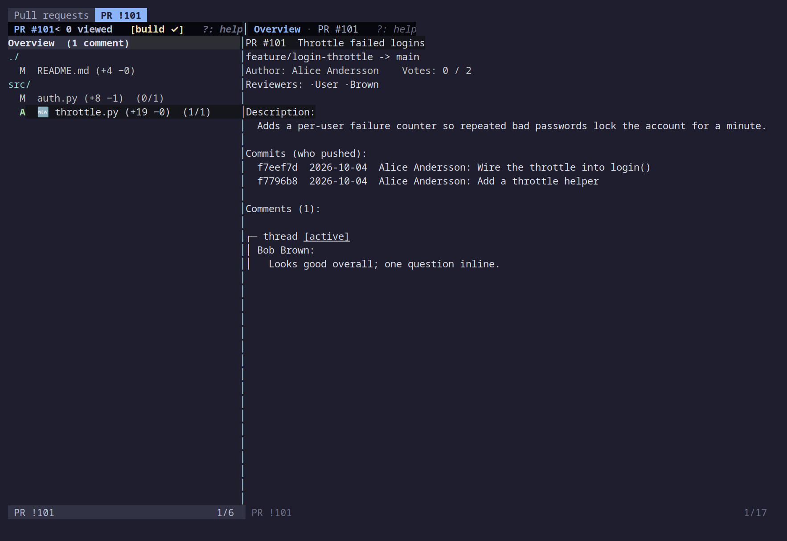
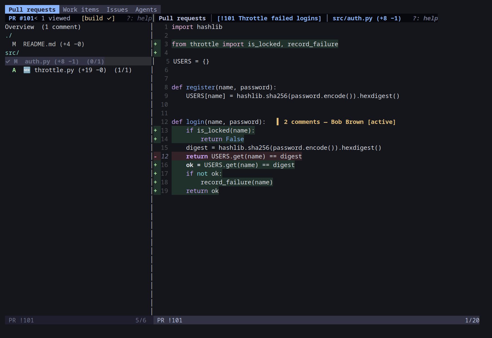
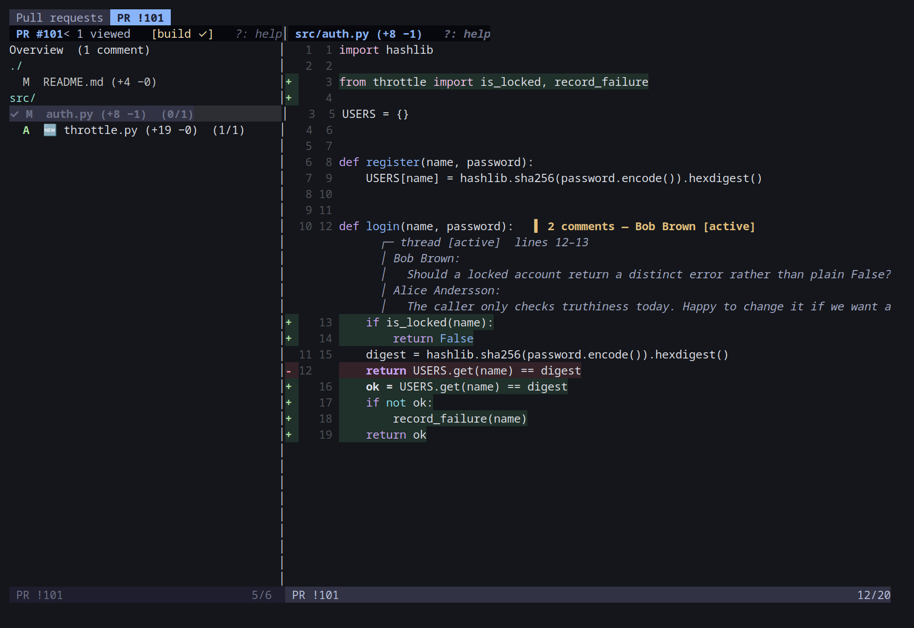
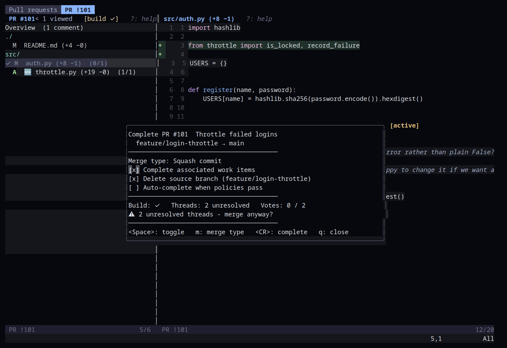
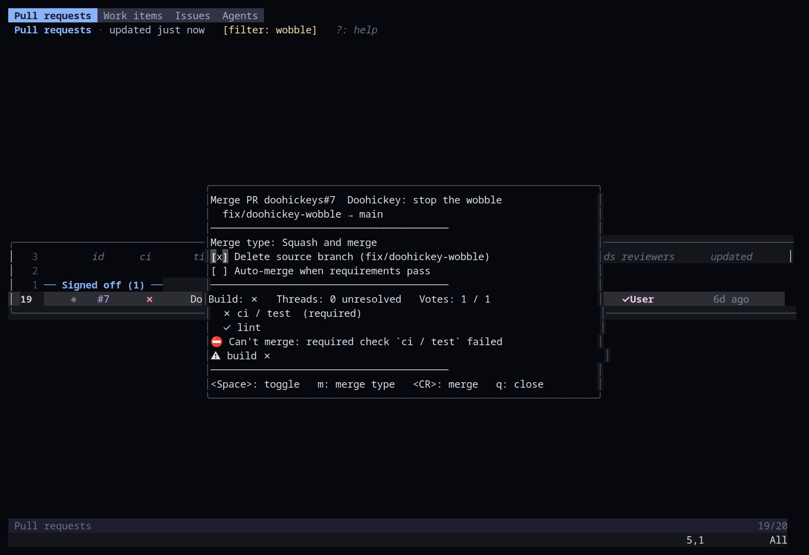

# Reviewer

_Part of the [azure-vicli](../README.md) docs._

## Reviewer

Opening a PR adds an inner tab to Pull requests with the file list on the
left and the selected content on the right. The first row is always the
Overview: title, description, commits, and PR-level comments.

The Overview's filetype is `azurecli-overview`, not `markdown`: only the
description and the comment bodies are highlighted as Markdown (with Vim's
own markdown syntax, minus its `markdownError`), so an `_` in a branch name
or a commit subject isn't flagged as an error. In a comment, a link reads
as its text with its address under the comment, as in the `K` popup, and
a bot's `[KEY]: value` lines are left out. The commit list and a
commit's file list are `azurecli-commits`. A `FileType markdown` autocmd or
a Markdown renderer (render-markdown.nvim, markview.nvim) no longer
attaches to these buffers; hook `FileType azurecli-overview` instead if you
want one there.

Several reviews stay open side by side inside the Pull requests tab: the
winbar's strip (`Pull requests │ !101 Fix auth │ [!102 Cache]`) lists them,
`]r` / `[r` and `g1`..`g9` switch, and each keeps its file list, diff and
cursor (and its own polling) while you're in another. `q` closes the one
you're in and goes to the one before it, the list when it was the first
([Inner tabs](commands-and-keys.md#keys)).







Every winbar in the reviewer follows the same shape as the dashboard's - what
you're looking at, then any active mode tags, then `?: help` instead of a key
legend:

| Surface | Winbar |
|---|---|
| File list | `PR #123 · feature/x → main · 14 files [· src/]   [active-only] [ignore-ws] [batch: 2] [since <sha> · N new iteration(s)]   ?: help` - the trailing `· src/` only appears when every changed file shares a directory prefix (see below) |
| Diff pane | `path (+12 −3)   [tags]   ?: help` - the same tags as the file list |
| Overview | `Overview · PR #123   ?: help` |
| Revision/peek buffers (`gd`/`gr`/`gf`) | `[ref] path   ?: help` |
| Commit views (`gc`) | `commit <sha> · <file/subject>   ?: help`, with `(no comments shown)` on a per-commit diff |

Files are grouped by directory, sorted, each directory shown once as a dim
header row (`src/DataSource/`) followed by its files indented to just their
basename - even a directory with a single file gets its own header, for
consistency. The directory prefix shared by *every* changed file in the PR
(e.g. a PR entirely under `src/backend/`) is trimmed from every header and
shown once in the winbar instead, rather than repeated on every row. Each
file row also carries its status letter from the range (`A` added, `M`
modified, `D` deleted, `R` renamed) and a `(+adds −dels)` tally from the
cached diff - `(?)` until that diff has landed - plus the existing comment
count/🆕 marker. A header row isn't a file, and the cursor never rests on
one: `j`/`k`, `gg`/`G`, a search or a click that lands on a header hops to
the next file row in the direction of travel.

File list:

| Key | Action |
|---|---|
| `j` / `k` | Move; the right pane previews the file as you go |
| `<CR>` | Open and focus the file |
| `C` | Comment on the whole file |
| `gC` | New PR-level comment |
| `]C` / `[C` | Next / previous comment, landed on in the diff pane - from where the diff's cursor is, on into the next file, as in the diff itself |
| `]c` / `[c` | Next / previous change, the same way |
| `gA` | Show only active (unresolved) comments |
| `gF` | Manage text filters that hide matching threads |
| `gw` | Toggle ignoring whitespace in diffs |
| `gi` | Toggle showing only changes since your last review |
| `gv` / `gm` | Vote / complete (on GitHub: review verdict / merge - see [On GitHub](#on-github)) |
| `gR` | Add a reviewer: a popup lists everyone who can review (on Azure the project's teams' members, on GitHub the repository's assignable people) and typing narrows it, best match first (fuzzy: `greg` finds "Stein, Gregory", `tal gross` finds "Gross, Tal"); a pause in typing also searches the host's directory for anyone outside those teams. `<C-n>`/`<C-p>` move, `<CR>` picks (on Azure, then optional or required). People already reviewing aren't offered - from the file list, a diff or the Overview |
| `gX` | Remove a reviewer: pick one of the PR's reviewers (with their vote), confirm, and they're gone. On Azure DevOps any reviewer, except one a branch policy requires (the server says no); on GitHub only a review that's still requested, since GitHub keeps a submitted review |
| `gp` | The plan of this PR's agent - the one fixing its comments, or the one whose plan opened it - as `<CR>` on its Agents row opens it; `gp` in the plan comes back here |
| `gW` | Pop up the work items linked to this PR (`<CR>` opens one, `gs` changes its state, `gl`/`gL` link/unlink); on GitHub, the issues it closes |
| `gl` / `gL` | Link a work item to this PR / unlink one (each a popup, mid-screen) |
| `gc` | Open the PR's commit list |
| `gB` | Toggle batch review for this PR |
| `gQ` | Show the queued batch-review items (`s` on a reply: the status its thread gets when sent) |
| `gS` | Submit the queued batch-review items, with a vote (on GitHub, as one review) |
| `<` / `>` | Resize the list (it keeps that width until you close the review) |
| `<BS>` | Back to the PR list |
| `q` | Close the reviewer |

Press `?` in the file list for a popup with these keys.

Diff pane:

| Key | Action |
|---|---|
| `]c` / `[c` | Next / previous change; at the last/first hunk in the file, continues into the next/previous file with any changes |
| `]C` / `[C` | Next / previous comment thread; at the last/first one in the file, continues into the next/previous file that has comments |
| `c` | Comment on the current line (on GitHub, only on or near a change) |
| `c` (visual mode) | Comment on the selected range of lines |
| `K` | View the comments on the current line in a popup, sized to them; a link reads as its text, with its address under the comment (`gx` on it opens it). `R` and `s` work inside it, plus `e`/`dd` to edit/delete a comment of yours |
| `R` | Reply to the thread on the current line |
| `s` | Set the thread's status (on GitHub: resolve or unresolve) |
| `]C` / `[C` | Next / previous thread |
| `gd` / `gr` / `gf` | Code navigation, see below |
| `za` / `<Space>` | Open or close the `· N unchanged lines ·` fold under the cursor (remembered, see below) |
| `zR` / `zM` | Unfold / fold them all |
| `<Tab>` | Expand the thread on the current line inline, or collapse it |
| `m` / `]m` / `[m` | Toggle the file's viewed mark / next / previous file not yet viewed |
| `gw` | Toggle ignoring whitespace in diffs |
| `gi` | Toggle showing only changes since your last review |
| `gc` | Open the PR's commit list |
| `<BS>` | Back to the file list |

Press `?` in the diff pane or the Overview page for a popup with its keys.

Where a run of removed lines is immediately followed by a run of added lines,
the part of each line pair that actually changed is highlighted more
strongly than the rest, so a one-word edit on a long line stands out instead
of the whole line reading as uniformly changed.

Comments, replies and status changes appear the instant you submit them,
tagged "(sending…)" until the server confirms. If the call fails the entry is
removed and the prompt reopens with your text, so nothing is lost. Threads
refresh in the background every `timing.poll_seconds` (30 s), slower while
Neovim is idle or unfocused, and new comments on your PR or on
threads you took part in raise a notification (both `vim.notify` and, unless
disabled, a desktop toast).

On a comment you authored yourself, `e` edits it (prefilled with its current
text) and `dd` deletes it, in the K popup or on the Overview page. Both are
optimistic the same way a new comment or reply is - an edit shows at once,
tagged "(sending…)" until confirmed, and reverts with your text preserved
for a retry if the call fails; a delete removes the comment at once and
restores it (and its thread, if it was the thread's only comment) on
failure.

The diff pane's gutter shows one line number: the new file's for a context
or added line, and the old file's, dimmed, for a removed one. Runs of
unchanged context beyond three lines of any change - or of any commented
line - are folded to `· N unchanged lines ·`; `za` / `<Space>`
(`toggle_fold`) opens or closes the one under the cursor, `zR` unfolds them
all and `zM` folds them again, and `]c` never lands inside one. The folds
you open are remembered per PR and file - when you come back to the file,
reopen the PR or restart Neovim - until a push changes that file's diff.
Vim's own `zo` / `zc` / `zA` and friends are remembered the same way. The
plain diff, the whitespace-ignoring one (`gw`) and the since-your-last-review
one (`gi`) each keep their own folds; they're stored next to the viewed
marks, in `azure-cli-viewed.json` under Neovim's data directory. (The
chat's change viewer shares the `diff` keys but doesn't fold-toggle or
remember folds - `toggle_fold` is the reviewer's.)
A UTF-8 byte-order mark at the start of a file isn't shown, and adding or
removing one doesn't count as a change. Syntax highlighting follows
Neovim's own filetype detection, so a `Dockerfile` or a `.csproj` is
coloured too.

A commented line's marker carries the thread's status (`[active]`,
`[fixed]`, ...) and a line whose threads are all resolved is dimmed;
`<Tab>` expands the thread right under its line, as virtual text, and
collapses it again. `K` still opens the full popup. (A GitHub thread is
only ever `[active]` or `[fixed]` - see [On GitHub](#on-github).)

Files you open with `<CR>` (or that `]c`/`]C` walk into) are marked viewed:
`✓` and dimmed in the file list, counted in the winbar (`14 files, 3
viewed`), and skipped by `]m` / `[m`, which jump to the next/previous file
not yet viewed. `m` toggles the mark by hand. A new push on the PR clears
every mark, since there's new content to look at. Every winbar in the
reviewer - the Overview and revision buffers included - shows the same mode
tags, plus `[N hidden]` when the active-only or text filters are hiding
threads; `?` repeats them on its first line.

`gm` shows the PR's title, branches, build state, unresolved thread count
and votes before completing, and warns when any of them argue against
merging. In the dialog `<Space>` toggles the checkbox under the cursor:
completing the linked work items (on by default - Azure DevOps moves each
one to its next state, as the web UI's "Complete associated work items"
does) and deleting the source branch; `m` (or `<Space>` on its row) cycles
the merge type; `<CR>` completes. Checking "Auto-complete when policies
pass" makes `<CR>` set auto-complete with those options instead - ADO then
completes the PR once its build and required reviewers pass; the box
starts checked when auto-complete is already on, and `x` cancels it. The
dashboard's `gm`
opens the same dialog. On success the reviewer closes. `gv` marks your current vote and
confirms a Reject, and the Overview's Votes line updates at once. `q` asks
before closing when batch-review items are queued or comment drafts are
unsent. A GitHub PR's dialog and verdicts differ - see
[On GitHub](#on-github).



### Comment editor

Every place text gets typed for a comment - `c` (inline or on a visual
selection), `C` (file comment), `gC`/`c` on the Overview (PR comment), `R`
(reply, including from inside the K popup or the Overview, where the popup
stays open behind it), `e` (edit) and the prompt a failed send reopens with -
opens a small floating editor instead of a single-line command-line prompt,
anchored just below the line it's about (or centred for a PR-level
comment/edit). A reply shows the thread centred with the editor right under
it, as wide as the thread. It opens in insert mode, starts 3 lines tall and grows to 8
as you type, with a rounded border and a title naming what it's for (e.g.
"Comment · path:42", "Comment · path:42–48" for a range, "Reply · Jane
Doe", "Edit comment", "PR comment"). The code line(s) being commented on (or
the thread being replied to) show dimmed just above the buffer as reference
text - never part of what gets submitted.

| Key | Action |
|---|---|
| `<CR>` (insert or normal mode) | Submit; with the `@` completion menu open it picks the entry |
| `<S-CR>` / `<C-j>` (insert mode) | A new line |
| `q` (normal mode) | Cancel |
| `<Esc><Esc>` | Cancel (the first `<Esc>` just leaves insert mode, like usual) |

Submitting empty text (or nothing typed at all) cancels instead. Cancelling
keeps whatever you'd typed as a draft, keyed by the PR and exactly what you
were commenting on (the same line, file, PR, or thread) - opening the editor
again for that same target starts from the draft, even after leaving and
re-entering the PR within the same session (drafts are in-memory and don't
survive a Neovim restart). A successful submit clears the draft.

Typing `@` opens completion over the PR's reviewers, then everyone else
seen this session (comment authors, people a search found); picking one
inserts their display name as plain text. To tag someone who isn't there,
press `<C-t>`: the same search-as-you-type picker as `gR`, and
`@Their Name` goes in at the cursor as a real mention. Azure DevOps only sends a notification for
an `@<GUID>` mention, never a plain-text one, so the editor translates every
`@Display Name` it recognises to `@<their GUID>` right before submitting -
azure-cli.py's `--list` carries each reviewer's id (an
`IdentityRefWithVote` id) alongside their name for exactly this. A name
that's typed but isn't a recognised reviewer is sent as plain text and
simply won't notify anyone. On GitHub the name is translated to the
reviewer's `@login` instead, and an `@login` typed by hand notifies too.
The other way round, an `@<GUID>` in a comment you're reading shows as
`@Display Name` (the name of a comment author with that id, or yours), or
`@someone` when nobody seen so far has that id.

### Per-commit diffs

`gc` (file list or diff pane) opens the PR's commit list - the same commits
the Overview's "Commits (who pushed):" block lists, as their own scrollable
buffer. `<CR>` on a commit there, or directly on one in the Overview, shows
that commit's changed files (its status letter and path); `<CR>` on one of
those shows that file's diff for that commit alone, not the PR's overall
diff. `<BS>` walks back a step the same way `gd`/`gr` do, and `q` goes all
the way back to whatever diff or Overview you started from. Comments never
show in a commit diff - they're anchored to the PR's final diff, not any one
commit along the way - and the winbar there says so.

### Images

An image in the description or a comment (``, ``, or
a link to one) opens with `<CR>` or `gx` on its line, in the Overview and the
K popup: azure-vicli downloads it with your PAT or token into Neovim's own
temp directory (a `0600` file, deleted when Neovim exits) and opens it in the
system viewer. The credential only goes to the PR's own server - the org's
host (on `dev.azure.com`, the org's own path), or GitHub's - never along a
redirect, and never on a command line or into the perf log. An image on any
other host opens in the browser as it is, without your credentials. SVG
isn't downloaded. On a line with no image, `<CR>` and `gx` do what they did
before (a commit line's `<CR>` still opens that commit).

With [snacks.nvim](https://github.com/folke/snacks.nvim)'s image module or
[image.nvim](https://github.com/3rd/image.nvim) installed, in a terminal that
can draw images (kitty, WezTerm, Ghostty; sixel terminals through image.nvim),
the Overview also shows the images under their lines (the first 10, up to
15 rows each) - neither plugin is required. `images = { inline = false }`
in `setup()` turns that off. If the plugin errors, inline images stay off
for the rest of the session and the error goes to `:AzureCli log`;
`<CR>` / `gx` still open them.

Nothing is drawn inline in the standalone launcher: it starts Neovim with
its own `init.lua` (`nvim -u standalone/init.lua`) in place of yours, which
adds only azure-vicli to the runtime path, so the image plugins your config
sets up through a plugin manager (lazy.nvim, packer, ...) aren't loaded
there. `<CR>` / `gx` still open images in the system viewer; for inline
images, use azure-vicli as a plugin in your own Neovim.

### Range comments

Select a run of lines in visual mode and press `c` to comment on the whole
range instead of a single line - both ends must be commentable and on the
same side of the diff, and a single-line selection is the same as pressing
`c` in normal mode. The comment appears at once against the range's first
line, with the rest of it picked out by a subtle highlight; `K` on that first
line shows the thread with its `lines N–M` span in the header.

### Batched review

By default every comment, reply or file/PR-level note goes out the moment
you submit it - the fast path above. `gB` (file list, diff pane or Overview)
instead turns on batch review for the rest of this PR: from then on, every
new comment, file comment, PR comment and reply is queued instead of sent,
shown at once the same way but tagged "(queued)" rather than "(sending…)",
and the winbar grows a `[batch: N]` tag. `gQ` opens a float listing the
queue - each item where it goes (a reply by its file and line) over the
start of its text; moving shows it in the diff, `<Tab>` goes there, `dd`
removes it, and `s` on a reply picks the status its thread gets once the
reply is sent (shown as `→ By design`; an agent's `draft_reply` can set it
too), `q`/`<Esc>` closes. `gS` prompts for a vote - the same choices `gv` offers, plus "No
vote" - then submits every queued item in order, each one flipping from
"(queued)" to "(sending…)" to confirmed in turn; a failed item stays in the
queue (still tagged) and the rest continue, then the vote (if you picked
one) is cast last. (On GitHub the queue goes as one review, all or
nothing - see [On GitHub](#on-github).) Batch mode turns itself back off once everything lands
cleanly; a failed submit leaves it on with just the failures still queued,
so `gS` again retries only those. The queue survives leaving and
re-opening the same PR within one nvim session.

### Chat

`i` (file list, diff pane, Overview, revision buffers) takes you to the
[chat panel](chat.md)'s input box, opening it if it's hidden. The agent is told which file, line, code and comment
thread is under your cursor, so "what do you think about this comment?" or
"triage this PR's comments" need no further explanation; with lines
selected, `<CR>` sends the selection along. Replies it drafts land in this PR's
batch-review queue, tagged "(queued)", for `gS`. Notes it leaves on lines
(`annotate_code`) show as virtual lines under them and are still there
after a restart - `]a` / `[a` jump to the next / previous one, on into the
next file that has any; once a later push changes a note's line, the note
says it may have moved. When it shows you
something ("show me where that's checked") the reviewer jumps to that file
and line. "Fix this comment" changes code in a separate worktree and asks
before pushing - see [Chat](chat.md#fix-this-comment).

### Changes since my last review

`gi` (file list, diff pane or Overview) toggles showing only what's been
pushed to this PR since your last review activity - your last comment,
reply or vote, whichever was most recent. Turning it on narrows the file
list to just the files that actually changed in that window, and every
diff shown is against the commit your last review left off at instead of
the PR's whole range; the winbar grows a
`[since <short-sha> · N new iteration(s)]` tag, and the Overview gains
a "Since your last review" line with the same count plus how many files
changed. `gi` again turns it back off. Because the source branch may have
been pushed to more than once since you last looked, "since" means since
the iteration (push) current at the time of your last activity, not since
the most recent push before it. On GitHub an iteration is a commit, and
the starting point is the commit your last review was on - see
[On GitHub](#on-github).

Comments anchored to the target-branch side of the diff ("L", i.e. lines
that were removed or that a comment was left on the base copy of the file)
are hidden while this mode is on: their line numbers are relative to the
target branch's copy of the file, not the commit this mode diffs from, so
there's no correct place to show them against the narrower diff - comments
on added/context lines ("R") are unaffected. If you haven't commented on or
voted on the PR at all yet, there's no "last review" to compare since and
`gi` says so instead of turning on; if every push happened before your last
review activity, everything in the PR already counts as "new" and `gi` says
so too, leaving the normal full-PR view in place; and if the commit your
last review left off at isn't available in this local clone anymore (a
force-push that rewrote history, or a shallow fetch), `gi` falls back to the
normal view with a warning rather than handing git a range it can't resolve.

### Follow up on my comments

`gu` (file list, diff pane or Overview) opens a picker of every thread YOU
started on this PR (the first comment has to be yours, a reply to someone
else's thread doesn't count), answering "did anything land near
what I asked about since I last reviewed?" without re-reading every file by
hand. It reuses `gi`'s own "last review point" (your last comment, reply or
vote) and base commit, so the two features always agree on "since when".

Each row is tagged with its state, then the file:line, status and the first
80 characters of your comment, then how many replies it has:

```
⚠ closed-as-is src/Qux.cs:7        [closed]   "this leaks the handle"              (0 replies)
✔ changed      src/Foo.cs:42       [active]   "did we handle the null case here?"  (1 reply)
– unchanged    src/Bar.cs:10       [active]   "typo: recieve -> receive"           (0 replies)
✔ addressed    src/Qim.cs:3        [fixed]    "extract this into a helper"         (1 reply)
? n/a          src/Baz.cs:5        [fixed]    "this branch looks dead"             (2 replies)
```

A thread on the source side (`R`) is `changed` when a `git diff --unified=0`
of the since-range touches a line within 3 of yours (i.e. something was
actually pushed near your comment - not just anywhere in the file) and
`unchanged` otherwise (including when the file has no changes in that range
at all). A thread on the target side (`L`, e.g. a comment left on a removed
line) is always `n/a` - its line has no meaningful position in the
since-range's diff, the same reason `gi` itself hides `L` comments. A
file-level or PR-level comment of yours (not anchored to a line at all) is
listed at the end under "Unanchored", ungraded.

The thread's own status crosses with that: a **resolved** thread (anything
but `active`/`pending`) reads `addressed` when something did change nearby
and **`closed-as-is`** when nothing did - somebody marked your comment
settled without the file moving. That is the row worth opening the picker
for, so it sorts above everything else and the summary line counts it
("… 0 of 3 threads have nearby changes, 1 resolved with no change nearby").
Resolving is not the same as fixing, and this is where the difference
shows; `addressed` rows sort last, there being nothing left to do.

The picker re-resolves `origin/<source>` every time it opens and keys its
cached diffs on that commit, so a push that lands while you have the
reviewer open changes what the rows say on the next `gu` - it never serves
a classification computed against an older tip.

The list is on the left, a preview of the file (source tip for an `R`/
unanchored row, target tip for an `L` row) on the right, centred on the
comment's line with any nearby since-range change highlighted. The
commented line is labelled at its end the same way it is in a diff buffer -
`▌ your comment · 1 reply [active]`, dimmed once the thread is resolved -
so it reads as *your comment* rather than as one more highlighted line
among the changed ones around it. A file-level comment is marked on line 1;
a comment whose line no longer exists in the file at that revision says so
instead of marking the last line as though it were there:

| Key | Action |
|---|---|
| `j` / `k` | Move; the preview follows |
| `<CR>` | Open the file in the diff pane on that line |
| `K` | View the full thread in a popup |
| `R` | Reply to the thread |
| `s` | Set the thread's status |
| `gA` | Toggle the active-only filter (see below) |
| `q` / `<Esc>` | Close |

A reply or status change updates that row (replies count / status) in
place without closing the picker.

The comment filters apply here like everywhere else: with `gA` on, only
your still-active threads are listed (the title says `· active only`), and
a `gF` text filter hides matching threads here too - so this picker never
disagrees with the diff or the Overview page about which comments exist.
`gA` is bound inside the picker as well and flips the reviewer's own
filter, not a private copy of it, so the diff, file list and Overview
behind the picker follow along. Everything is classified before the picker
opens, so toggling the filter back off is instant - nothing is re-fetched. If you haven't commented on this PR at
all, or `gi`'s own "no last review to compare since" conditions apply (see
above), `gu` says so instead of opening.

### On GitHub

A GitHub PR (from an account with `host: github`, see
[GitHub accounts](configuration.md#github-accounts)) opens in the same
reviewer, with the same keys. What differs:

- **Names.** A PR is `repo#12` rather than `!101` - a number alone is
  ambiguous across repositories.
- **Verdicts, not votes.** `gv` offers GitHub's three: Approve, Request
  changes and Dismiss my review. Request changes asks what needs changing
  (GitHub wants a reason; left empty it sends "Changes requested."), and
  dismissing needs write access to the repository. There's no Approve with
  suggestions or Reject. On the dashboard, changes requested shows as `✗`.
- **Resolved or not, not statuses.** `s` offers Unresolved and Resolved,
  so thread markers only ever read `[active]` or `[fixed]`. The
  Conversation tab is one thread on the Overview, with no status: replies
  to it post a new comment there, and `s` on it says nobody resolves it.
- **Line comments only near changes.** GitHub takes a line or range comment
  only on a changed line or the few around one - not on lines you unfolded
  with `zR`. Comment on the file (`C`) for anything else.
- **Mentions** go out as `@login`. A login typed by hand notifies its
  owner too.
- **`gS` is one review.** The queue goes to GitHub as a single review: its
  line comments and replies, the PR-level comments and Conversation replies
  as its text, and the verdict you pick (or Comment only; there's no
  Dismiss here). The author gets one notification, and if any part fails
  GitHub gets nothing and the whole queue stays queued.
- **Iterations are commits.** `gi`'s "N new iteration(s)" counts commits
  (and force-pushes), dated by commit date. "Since my last review" starts
  from the commit your last submitted review was on - a review with no
  comments counts - and `gu` uses the same point.
- **Merging (`gm`).** The dialog reads the PR fresh from GitHub first:
  - its merge types are the ones the repository allows (Squash and merge,
    Create a merge commit, Rebase and merge);
  - it lists the checks, `(required)` where GitHub says so;
  - anything that stops the merge - a conflict, a draft, the base moved on,
    a failing or pending required check, a review still needed, changes
    requested - is shown as `⛔ Can't merge: …`, and `<CR>` refuses; when
    GitHub blocks it for none of those, the reason is "blocked by <base>'s
    branch protection (e.g. unresolved conversations, signed commits)";
  - a check that failed but isn't required is a warning, not a blocker:
    "check `x` failed (not required)", or "some checks failed (not
    required)" when GitHub doesn't say which;
  - there's no work-items row (an issue closes through its `Closes #n`
    line instead);
  - "Auto-merge when requirements pass" is there only when the repository
    allows auto-merge, and then the repository's own setting decides
    whether the branch is deleted;
  - a direct merge (not auto-merge) has the "Delete source branch"
    checkbox, on by default;
  - a branch in a fork is never deleted, even with that box checked.
- **Checks, not builds.** The build state is the head commit's checks.
  Re-queuing re-runs the failed jobs of its failed GitHub Actions runs;
  the agent's build log is those jobs' failure annotations and the failed
  step's log, and its test results are their annotations (GitHub has no
  test counts, so a run's total is its failures).
- **Issues, not work items.** `gW` lists the issues the PR will close
  (including ones linked on github.com); `gl` / `gL` add or remove a
  `Closes #n` line in the PR's description, which GitHub honours only for a
  PR into the default branch - `gl` warns otherwise. The issues come from
  the [Issues tab](work-items.md#issues-github)'s project.
- **Viewed marks** stay local, as on Azure; they don't tick GitHub's
  "Viewed" box.



## Code navigation

The reviewer navigates code across the whole repository at the PR's revision
without a checkout or a language server. `git grep` searches the source
branch (the target branch when the cursor is on a deleted line), and
`git show` reads files at that revision.

| Key | Action |
|---|---|
| `gd` | Go to the definition of the identifier under the cursor |
| `gr` | Find references |
| `gf` | Open the current file at the PR's revision, on the same line |
| `g/` | Search text across the PR's changed files |

`gr` and `gd` open a peek view: hits on the left, and on the right the file
at that revision centred on the selected hit with the line and every
occurrence highlighted. Moving through the list re-previews. `<CR>` opens the
hit, `q` closes the peek. `g/` uses the same peek view for plain text you
type, searched only across the PR's changed files at the source branch,
case-insensitive unless the text has an uppercase letter and prefilled with
your last search.

Opened files and previews show the PR's changes: added lines in green, and
the lines the PR removed in red as virtual lines where they used to be. In a
revision buffer `gd` and `gr` keep working, `<BS>` walks back one jump, and
`q` returns to the diff. Press `?` there for a popup with these keys.

The definition lookup is a heuristic that ranks grep hits by declaring
keywords, modifiers, and shapes such as a type followed by `Name(`. When one
line clearly wins it opens directly; ties show the candidates; no plausible
definition falls back to the references list.
