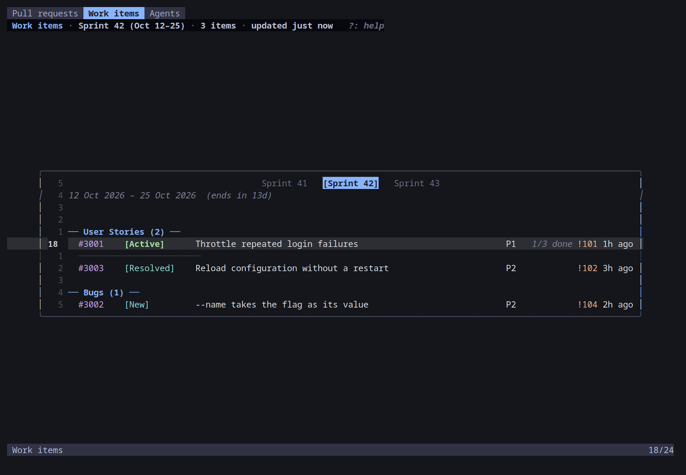
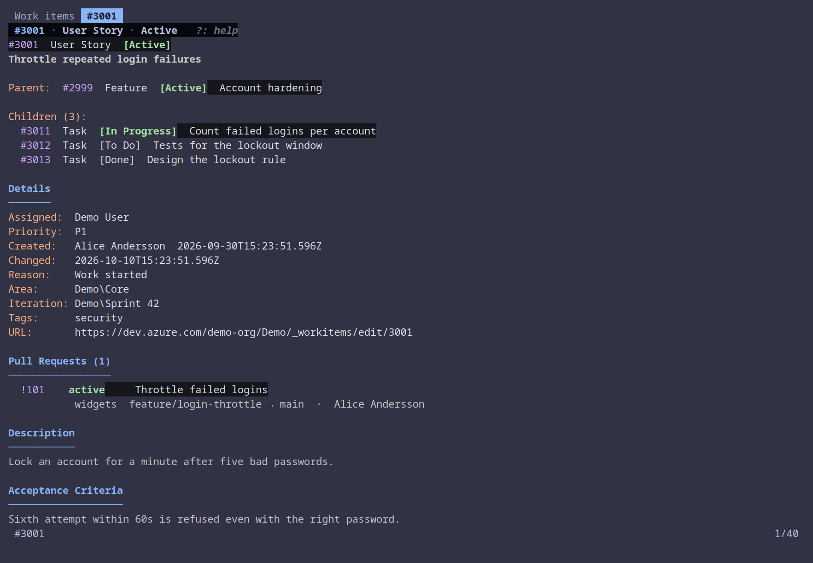

# Work items

_Part of the [azure-vicli](../README.md) docs._

## Work items

Press `W` in the PR dashboard. The work-items dashboard shows the user stories
and bugs assigned to you in the current sprint, with tabs for the other
sprints of the quarter (or, with `work_items.sprint_scope: all`, every sprint
the team has - see below). The last tab, **No sprint**, lists your open
items whose iteration is the team's backlog iteration (from the team's
settings) or the project root, which no sprint's tab shows; `gi` to it, or
`n` on it, files an item there. Its winbar is `Work items · Sprint 42 (Sep 1–14) ·
N items   ?: help`; the detail view's is `#123 · type · state   ?: help`.





| Key | Action |
|---|---|
| `<CR>` | Open the item: parent, children, description |
| `gs` | Change the item's state in a popup, optionally for its children too (see below) |
| `n` | New work item: type, title, and parent (if the cursor is on one) |
| `ga` | Assign the item under the cursor: a popup with "(me)" and the team; typing narrows it and also searches everyone the server knows (on Azure DevOps the identity directory, on GitHub the repository's assignable people), so someone outside the team turns up too. "(type a name…)" takes any name (empty = me) |
| `gp` | Set the item's priority (1-4) |
| `ge` | Edit the item: opens it with every field that can change in one popup - title, state, assignee, priority, sprint, parent, tags, hours (see [Editing an item](#editing-an-item)) |
| `gi` | Move the item to another sprint of the quarter |
| `gU` | Move the item under another parent, or off its own (see below) |
| `gl` | Link a pull request to the item under the cursor |
| `gL` | Unlink a pull request from the item under the cursor (a popup of its linked PRs) |
| `gy` | Copy the item's link |
| `o` | Open the item in the browser |
| `/` | Filter by id, title, state or assignee |
| `T` | Tree view: everything under each item indented beneath it (remembered) |
| `za` or `<Space>` / `zR` / `zM` | Tree: fold/unfold an item's children / unfold all / fold all |
| `gR` | Open a pull request linked to the item (a picker when there are several) |
| `<S-Tab>` / `<Tab>` | Previous / next sprint |
| `[r` / `]r`, `g1`-`g9` | Previous / next inner tab, or the n-th (`g1` is this list) - see below |
| `{n}gt` | Jump to sprint n |
| `gg` / `G` | First / last row (with a count, that row) |
| `r` | Refresh |
| `P` | Back to the PR dashboard |
| `I` | The [Issues tab](#issues-github) - only when a GitHub account has `issues:` |
| `A` | The [Agents screen](chat.md#several-agents-at-once) |
| `i` | Type in the [chat panel](chat.md) (opening it if it's hidden); the agent knows which work item is under the cursor ("create a branch from develop for this work item") |
| `gP` | Start an agent that plans the item under the cursor (in visual mode: one per selected row) - see [Several agents at once](chat.md#several-agents-at-once) |
| `q` | Quit |

Press `?` for a popup with these keys. `ga`, `gp` and `gi` apply to the
row immediately and are reverted with an error if the call fails, the same
optimistic pattern the PR dashboard uses for votes and completion. `n` has no
id to show until the server answers, so it notifies and reloads the active
sprint's list instead.

Work items you open stay inside the Work items tab (GitHub issues inside
Issues) as inner tabs: the tab line shows the one tab, and its winbar a
strip like `Work items │ #3001 Throttle … │ [#3002 …]`. `]r` / `[r` and
`g1`-`g9` move between them, each keeping its cursor; opening an item
that's already open goes to it. `q` / `<BS>` in an item goes to the one
before it, or the list - or back to where you opened it from, when that
was outside its tab (`gW` in a review, the chat).

### Changing the parent (`gU`)

`gU` on a row, or in the item view, opens a picker of who could be the
item's parent: the project's open items on a higher backlog level than its
type (a Task gets the stories, bugs, features and epics; a Feature the
epics), read from the team's process configuration - the 200 changed last.
A server that won't say what its levels are (an old TFS) gets the open items
of any other type, and the picker's title says so. Then "(type an id…)" for
an item that isn't listed, and "(no parent)" to take it off its parent. The
current parent is marked "(current)".

The move is one update on Azure DevOps: the old parent link is removed and
the new one added together, so the item is never under two parents, or left
with none by accident. If someone changed the item in between, nothing is
changed and you're asked to try again. Afterwards the tree regroups, and the
item view and both parents' views refresh. When it fails, the message says
the parent wasn't changed and what it still is.

On GitHub the issue becomes a sub-issue of the one you pick (GitHub moves it
off its old parent in the same call); "(no parent)" removes it from its
parent. Issue types have no levels, so every open issue in the project is
offered but the issue itself and what's under it. A GitHub Enterprise Server
without sub-issues says so instead.

### Tree view (`T`)

`T` shows everything under each item indented beneath it (children, their
children, and so on), the way the Azure DevOps taskboard groups tasks under
their story:

```
── User Stories (2) ──
 ▾#3001    [Active]      Throttle repeated login failures   P1   1/3 done !101 1h ago
  ├ #3011   [In Progress] Count failed logins per account   Alice Andersson
  ├ #3013   [Done]        Design the lockout rule           Alice Andersson
  └▾#3012   [To Do]       Tests for the lockout window      0/1 done  Alice Andersson
    └ #3014   [To Do]       Cover the sixth attempt         Bob Brown
```

Everything under an item is fetched whatever its type or assignee, in one
recursive query, so a story's tasks show even when someone else has them;
those rows show the assignee in place of the priority and age. (On a server
that won't run the recursive query, only direct children are shown.) An
item whose parent is also in the list moves under that parent instead of
having its own row. Every key works on a child row too (`gs`, `<CR>`, `ga`,
...). The filter keeps a parent when it or anything under it matches.

`za` (or `<Space>`) folds or unfolds the children of the item under the cursor (▾ open,
▸ folded); on a child row it folds that child's parent and moves to it.
`zR` unfolds everything and `zM` folds everything. `T` again turns the tree
off. Whether it's on is remembered between sessions.

### Progress

An item with children shows how many are finished, e.g. `1/3 done`, with
or without the tree. A child counts as done when its state is in the
Completed category (Done, Closed); removed children aren't counted. The
count turns green once everything is done.

### Changing state (`gs`)

`gs` opens a popup, from the list or the detail view:

```
Set #3001  User Story · Active
  Throttle repeated login failures

State:   ‹ Implemented ›   (1/4)
Reason:  ‹ (default reason) ›

[ ] Also set children (1 of 3)
    [ ] #3011 Task  In Progress  (already In Progress)  Count failed logins per account
    [ ] #3012 Task  To Do → In Progress  Tests for the lockout window
    [ ] #3013 Task  Done → In Progress  Design the lockout rule

<Space>/l, h: cycle or toggle   <CR>: apply   q: close
```

`State` offers only the states the item's workflow allows from its current
one, and `Reason` the reasons ADO has recorded for that transition (plus
the default and a free-text choice). Move the cursor to a row and cycle it
with `<Space>`/`l` (forward) or `h` (back).

"Also set children" starts unchecked. Children are often another type with
their own state names (a Task has no "Resolved"), so each child is mapped
by the state's category (Proposed, In Progress, Resolved, Completed,
Removed): the same state if that child can move to it, otherwise the state
in the same category it can move to. A child already there, or with no
state in that category, is listed with the reason and can't be checked.
Children that would move backwards (a Done task when the story goes back
to Active) or that were removed start unchecked, but `<Space>` on a child
checks it. `<Space>` on a child while the box is off picks just that child.

**Several items at once:** select rows with `V` and press `gs`. The first
selected item chooses the state and reason; every other selected item is
listed under "Also set the other selected items" with the state it would
move to, mapped the same way as children below, and starts checked. One of
the same type going to the same state gets the same reason; the rest get
their type's default.

`<CR>` sets the item first and, only if that succeeds, its checked children,
each with its type's default reason. A child that fails is reported on its
own; the item's change stands. Grandchildren are included too, indented
under their parent, and mapped the same way.

### Linked pull requests

A row with linked pull requests shows them after its priority: `!101`, or
`!101 +2` when there are more. The detail view lists each one under **Pull
Requests** with its status (active, draft, completed, abandoned), title,
repository, branches and author:

```
Pull Requests (1)
─────────────────
  !101    active     Throttle failed logins
           widgets  feature/login-throttle → main  ·  Alice Andersson
```

`gR` opens a linked PR, from the list or the detail view (`<CR>` on one of
those lines in the detail view does the same). It opens in the reviewer when
the PR dashboard's list has that PR, which is where the reviewer gets the
PR's details. Otherwise, for example a completed PR or one you're not on, it
opens in the browser. A PR the server won't return (deleted, or no access)
is still listed, by its id alone.

### Editing an item

`ge` - on the list or in the item - opens the item (or goes to its tab)
with a popup over it titled **✎ Editing Task #3011**, its border in the
warning colour, listing everything that can change: title, state, assigned
to, priority, sprint, parent, tags, the hours its type has (Original
estimate, Remaining work, Completed work - a Task's, usually) and, on
GitHub, the description. `<CR>` on a field changes it - text in a one-line
popup, a choice from a list - but only holds the change: it's marked `●`
with its old value beside it, and the line at the top counts what isn't
saved yet. `<C-s>` saves them all; a change that fails stays held, marked
`✖`. `u` takes back the one under the cursor, and `q`/`<Esc>` closes,
asking first while anything is held. State and parent are their own
popups (`gs`'s and `gU`'s), which save at once - the row says so.

The item's view shows its hours under Priority ("original 8 h · remaining
3 h · completed 5 h", `—` for one not set). An empty hours value clears
that field; `1,5` and `1.5` are both an hour and a half.

Linking works from either side, each through a popup picker (`<CR>` picks, `q` closes): `gl`/`gL` here link and unlink a PR on the item, and `gl`/`gL` on the PR dashboard or in the reviewer link and unlink a work item on the PR. Either way both dashboards, and an open detail view, show the change straight away.

In the detail view `<CR>` on a parent or child opens it, `gs` changes state,
`gU` changes the parent (see above),
`ga`/`gp`/`gi` edit assignee/priority/sprint (re-rendering the
detail on success), `ge` opens the edit form (below), `o` opens the browser, `<BS>` returns to the list, and
`?` shows its keys. It also shows the item's discussion and linked pull
requests (above): `gc` posts a comment (shown at once, tagged "(sending…)" until the
server confirms), `gl` links a pull request by id - resolving its org,
project and repository from the PR dashboard's cache when it's known there,
otherwise prompting for the repository name - and `gL` unlinks one, picked
from the item's current links. `gl` is also available on the dashboard, for
the item under the cursor. The discussion list comes from a REST endpoint
some older on-prem TFS instances don't expose; there the item still loads
normally, with the discussion showing as empty instead of failing the fetch.

The collection and project are the configured account's `org_url` and
`project_name` (see [Configuration](configuration.md#configuration)); team, assignee and item
types come from that same account's `work_items:` block - `team` is required
to enable this dashboard at all, `assignee` defaults to your own signed-in
display name, and `types` defaults to `User Story, Bug`. Every one of these
can still be overridden with the `AZVICLI_WI_*` variables listed below, and
`AZVICLI_WI_ACCOUNT` picks a different account's `work_items:` block when
more than one account has one. With no `work_items:` block configured
anywhere and no `AZVICLI_WI_TEAM` override, this dashboard shows that
diagnostic in its buffer instead of any work items.

Sections (and the `n` type picker) follow `work_items.types:` - configure
`types: [Task, Feature]` and you get Tasks and Features sections instead
of the default User Stories and Bugs. `/` filters by id, title, state or
assignee as you type (`<Esc>` clears). `ga` picks from the team's members
(plus "(me)" and typing a name), `gl` picks from the PR dashboard's cached
list (or takes an id), and `gL` unlinks from the dashboard as well as the
detail view. An empty description shows `(none)`.

### States and sprint scope

`work_items.states:` (see [Configuration](configuration.md#configuration)) is an ordered
list of the states this account's work items can be in - order is rank
(first = most actionable, sorted to the top of each section) and also picks
the `[state]` token's colour by position: 1st → `AzureCliWiNew`, 2nd →
`AzureCliWiActive`, last → `AzureCliWiRemoved`, second-to-last →
`AzureCliWiClosed`, everything else → `AzureCliWiImplemented`. A state a
work item reports that isn't in the list ranks last with a neutral colour
(`AzureCliWiOther`) rather than colliding with a configured one. Left
unconfigured, both dashboards use the exact rank/colour mapping they always
have (`Active`/`In Progress` first, then `New`, `Implemented`, `Resolved`,
`Closed`, `Removed` last) - nothing changes for an existing install. The
mapping itself lives in `lua/azure-cli/workitems/states.lua`, shared by
`workitems/dashboard.lua` and `workitems/view.lua`.

`work_items.sprint_scope:` picks what the tab bar shows: `parent` (default)
is today's behaviour - tabs are the siblings under the current sprint's
parent node (typically a quarter or release). `all` widens that to every
iteration the team has at all, ordered by start date with the current one
still focused. The tab bar shows a window of tabs around the active one
(with `‹`/`›` markers) whenever there are more than fit the window width, so
`all` scope's usually-longer list is handled the same way a wide `parent`
group already was.

## Issues (GitHub)

Press `I` (or run `:AzureCli issues`) for the issues dashboard: the same
screens as the work-items dashboard, showing the GitHub Projects v2 project
in a GitHub account's `issues:` block (see
[GitHub accounts](configuration.md#github-accounts)). `I` and the Issues tab
exist only when an account has that block. On an Azure-only setup there's no
`I` key, no tab and no help line. `W` and `I` are separate tabs that share
nothing, so `#7` on one never refreshes or replaces `#7` on the other. `W`
from the Issues tab goes back to the work items.

What's different on GitHub:

- **Ids.** An issue's id is its number, or `owner/repo#n` (or `owner~repo~n`).
  A bare number that two of the project's issues share is refused, and
  you're asked for `owner/repo#n` instead.
- **Tabs** are the project's iterations (its Iteration field): the current
  one, the ones after it, and the last 3 finished ones, then a last
  **No iteration** tab with the open issues that have none. A project with
  no Iteration field uses the repository's open milestones, with a last
  **No milestone** tab, and one with neither gets a single tab for the
  whole project. `gi` to the No iteration (or No milestone) tab clears the
  issue's iteration (or milestone).
- **The list** shows the issues assigned to you in that iteration, or
  everyone's with `issues: { scope: all }`. Issues are grouped by their
  issue type, or under Issues when the repository has no types.
- **State** is the project's Status field, plus Closed. In the `gs` popup,
  Closed has the reasons completed and not planned. Setting a Status such as
  Done doesn't close the issue; the project's own workflow does that if it's
  set up to. Setting a Status on a closed issue reopens it. An open issue
  with no Status shows as "No Status".
- **`n`** creates an issue in the open iteration, assigned to you and added
  to the project. On the No iteration tab and the whole-project tab no
  iteration is set. With the
  cursor on an issue, it offers to make the new one a sub-issue of it. The
  type prompt is skipped when the repository has no issue types. If GitHub
  makes the issue but a later step fails (adding it to the project, its
  iteration or its parent), it says which, and the issue stays created.
  After the title (and parent) it opens the comment editor for the issue's
  description: `<C-s>` saves it, and an empty one or `q` creates the issue
  without one.
- **`T`** shows sub-issues under their parent.
- **The detail view** shows the body as written, in Markdown, under
  "Description"; the repository as "Repository"; and comments under
  "Comments". `gc` adds a comment. `gE` writes or edits the description in
  the same editor, prefilled with the current one: `<C-s>` saves it and
  the view refreshes, an emptied editor clears it, and `q` (or saving it
  unchanged) writes nothing. Work items on `W` don't have `gE` yet: Azure
  DevOps descriptions are HTML, and the detail view shows them flattened
  to text, so writing that back would lose their formatting.
- **`ga`, `gp`, `gi`** set the assignees (GitHub logins), the
  project's Priority field (when it has one) and the iteration; `ge`'s
  form sets those, the title and the labels (as Tags).
- **Linked pull requests** are the ones GitHub lists as closing the issue,
  shown as `repo#7`. `gR` opens one.
- **`gl`/`gL`** link and unlink a GitHub pull request. GitHub has no other
  way to link an existing PR to an issue, so `gl` adds a `Closes #12` line
  to the PR's description (`owner/repo#12` across repositories) and `gL`
  removes it. GitHub honours it only on a PR into the repository's default
  branch, and closes the issue when that PR merges; for a PR into another
  branch you're told the line won't link it. On the PR dashboard and in the
  reviewer, `gW` on a GitHub PR lists the issues it closes and opens them
  here.
- **`i` and `gP`** work as on `W`: the chat's board tools then work on the
  issue (see [the chat](chat.md#issues-on-github)), and each `gP` agent plans
  its issue.

Your key overrides for the `workitems` and `workitem_view` surfaces apply
to both tabs.
